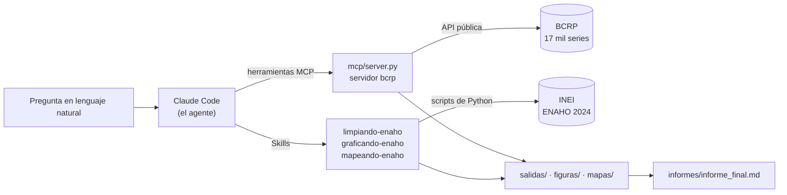
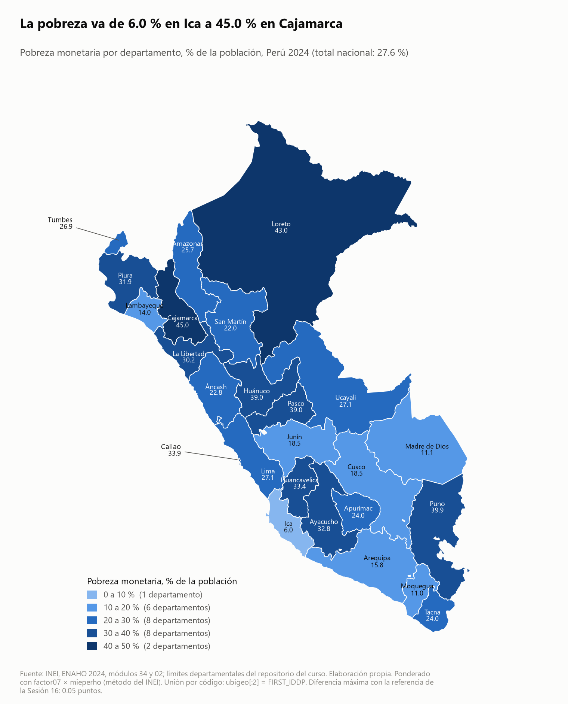
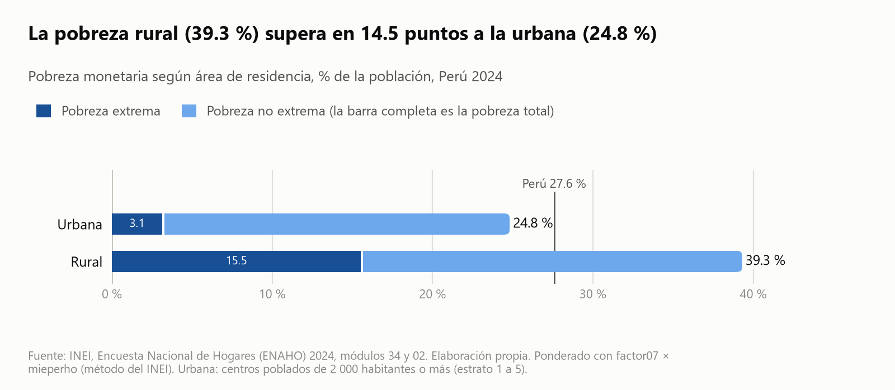

# Tarea_4

Agente de investigación socioeconómica: MCP, Skills y datos oficiales del Perú.

Tarea 4 del curso Python Intermedio ([issue #201](https://github.com/d2cml-ai/Data-Science-Python/issues/201)).
Claude Code coordina un servidor MCP con las series del BCRP y tres Skills que procesan la ENAHO 2024 del INEI, y
responde preguntas con cifras que se pueden rastrear y reproducir.

> **Estado:** Parte 1 (servidor MCP del BCRP) y Parte 2 (Skills de la ENAHO) terminadas. Las Partes 3 y 4 se
> completan en las siguientes entregas.

## 1. Objetivo del proyecto

Construir un agente que responda preguntas sobre la realidad socioeconómica del Perú con datos oficiales: las series
del Banco Central de Reserva (BCRP), por MCP, y los microdatos de la ENAHO 2024, por Skills de Claude Code. Cada
cifra la calcula Python y no el modelo, y sale con su código de serie o su procedimiento, su periodo y su fuente.

## 2. Arquitectura general del agente



| Pieza | Dónde está | Qué hace |
|---|---|---|
| Servidor MCP `bcrp` | `mcp/server.py` | Busca, descarga y resume series del BCRP; compara los 25 departamentos |
| Configuración MCP | `.mcp.json` | Conecta el servidor a Claude Code (alcance de proyecto) |
| Skills de la ENAHO | `.claude/skills/` | Limpian y validan los módulos 34 y 02, grafican y mapean la pobreza ponderada |
| Registro de ejecuciones | `scripts/registro.py` | Corre `claude -p` y guarda cada llamada a herramientas como evidencia |
| Copia limpia | `scripts/espacio_limpio.py` | Copia el proyecto sin salidas, para correr a Claude Code desde cero |
| Exportar conversaciones | `scripts/exportar_conversacion.py` | Pasa la sesión de Claude Code a Markdown y JSON, sin datos personales |

## 3. Herramientas MCP

El servidor parte del proyecto de la [Sesión 04](https://github.com/d2cml-ai/Data-Science-Python/tree/main/sessions/04-mcp-claude-code/proyecto)
(FastMCP 4). `buscar_series` venía hecha; el resto se completó o se agregó aquí.

| Herramienta | Qué hace | Ejemplo de argumentos |
|---|---|---|
| `buscar_series` | Busca entre las 17 167 series del catálogo del BCRP por palabras clave | `texto="ipc 12 meses"` |
| `serie` | Descarga los datos de una serie entre dos fechas (diaria, mensual, trimestral o anual), sin los «n.d.», con el enlace a la API y a la tabla web del BCRP | `codigo="PN01273PM", desde="2024-01", hasta="2024-12"` |
| `resumen` | Primero, último, cambio, variación %, promedio, máximo y mínimo con su periodo; las cuentas las hace Python | `codigo="PN01273PM", desde="2020-01", hasta="2024-12"` |
| **`panel_departamental`** (propia) | Trae un indicador anual del BCRP para los **25 departamentos** con el **código del INEI** (`ccdd`, el mismo de `ubigeo[:2]` en la ENAHO y de `FIRST_IDDP` en el mapa), con puesto, variación entre dos años, total nacional, promedio, mediana y extremos; puede guardar la tabla en `salidas/bcrp/` para unirla con la ENAHO sin copiar cifras a mano | `indicador="credito directo", anio=2024, anio_base=2020` |

**Por qué la herramienta propia.** El BCRP publica 23 indicadores por departamento (crédito, depósitos, gasto e
inversión pública, afiliados al SPP, PBI, electricidad, etc.), pero cada departamento es una serie distinta y la API
no trae el código territorial. `panel_departamental` resuelve las 25 series de una vez, las asigna a su código del
INEI con Lima y Callao separados, y avisa qué departamento falta (por ejemplo, el PBI departamental no trae Callao).
Es el puente entre el MCP del BCRP y las Skills de la ENAHO.

| Recurso o prompt | Qué devuelve |
|---|---|
| Recurso `bcrp://serie/{codigo}` | La ficha de una serie: nombre, frecuencia, inicio, fuente original y enlaces |
| Recurso `bcrp://indicadores-departamentales` | Los 23 indicadores que acepta `panel_departamental`, con sus variantes y años |
| Prompt `informe(tema, desde, hasta)` | Instrucciones para un informe con cada cifra citada (código, periodo y fuente), sin cuentas a mano y con limitaciones |

Los errores son explícitos: un código que no existe, una fecha mal escrita, un periodo anterior al inicio de la serie
o un año que el BCRP aún no publica devuelven un mensaje que lo dice, en vez de un dato inventado.

## 4. Skills de la ENAHO

Tres Skills en `.claude/skills/`, según el método de la
[Sesión 16](https://github.com/d2cml-ai/Data-Science-Python/tree/main/sessions/16-skills-enaho). Cada `SKILL.md` dice
cuándo usarla y qué comando correr; las cuentas las hacen sus scripts, no el modelo.

| Skill | Qué hace | Scripts | Salidas |
|---|---|---|---|
| `limpiando-enaho` | Baja los módulos 34 y 02, los lee sin convertir categorías y con las llaves como texto, normaliza los nombres, filtra a los residentes habituales, une personas y hogares con `merge(validate="m:1")`, pondera y valida. Si una validación esencial falla, no guarda la base y termina con error | `descargar.py`, `limpiar.py`, `consultar.py` | `salidas/personas_2024.parquet`, `salidas/hogares_2024.parquet`, `salidas/validacion.txt`, `salidas/indicadores.csv` |
| `graficando-enaho` | Gráficos ponderados de la pobreza por área, sexo (de la persona y de quien encabeza el hogar), edad, departamento y dominio, con título que dice el hallazgo, unidad, año y fuente | `graficar.py` | `figuras/pobreza_*.png` y un CSV gemelo con las cifras de cada uno |
| `mapeando-enaho` | Mapa coroplético de los 25 departamentos unido por código (`ubigeo[:2]` = `FIRST_IDDP`), con Lima y Callao separados, comparado con la referencia de la Sesión 16 | `mapear.py` | `mapas/pobreza_departamento_2024.png` y su CSV, `salidas/comparacion_mapa.csv` |

**Validación: 19 de 19 verificaciones aprobadas** ([`salidas/validacion.txt`](salidas/validacion.txt)).

| Indicador | Obtenido | Referencia |
|---|---:|---:|
| Pobreza monetaria nacional, método del INEI (sumaria con `factor07 × mieperho`) | 27.58 % | 27.6 % |
| Pobreza monetaria nacional, residentes con `facpob07` | 27.53 % | 27.6 % ± 0.1 |
| Residentes habituales | 108 664 | 108 664 |
| Unidades territoriales con dato | 25 | 25 |
| Pobreza urbana / rural | 24.81 % / 39.30 % | 24.8 % / 39.3 % |
| Lima Metropolitana / pobreza extrema | 28.21 % / 5.50 % | 28.2 % / 5.5 % |
| 25 departamentos frente a la Sesión 16 | diferencia máxima de 0.05 puntos | — |

**Dos ponderaciones, cada una con su unidad de análisis.** La pobreza de un territorio o de un tipo de hogar se
calcula como el INEI, con la sumaria ponderada por `factor07 × mieperho`, y reproduce las cifras oficiales. La
pobreza según un rasgo de la persona (sexo, edad) usa a los residentes con `facpob07`. Un promedio simple daría
25.61 %: por eso todo se pondera.

**Coordinación entre Skills.** Las de gráficos y mapas revisan primero si existe la base limpia; si no, usan antes
`limpiando-enaho`. Prueba: ante el pedido *«Haz un mapa de la pobreza monetaria por departamento con ENAHO 2024»*,
en una copia del proyecto sin salidas, Claude Code activó `mapeando-enaho`, vio que faltaba la base, activó
`limpiando-enaho`, corrió la limpieza y después el mapa
([registro completo](evidencias_ia/skills/01_mapa_coordinado.md)).





Los demás gráficos: [sexo](figuras/pobreza_sexo.png), [edad](figuras/pobreza_edad.png),
[departamentos](figuras/pobreza_departamento.png) (y [con Piura resaltado](figuras/pobreza_departamento_piura.png)),
[dominios](figuras/pobreza_dominio.png).

## 5. Fuentes y descarga de los datos

| Fuente | Datos | Enlace |
|---|---|---|
| BCRP | Series estadísticas (API pública, sin clave) | https://estadisticas.bcrp.gob.pe/estadisticas/series/ |
| INEI | ENAHO 2024, módulo 34 (sumaria) | https://proyectos.inei.gob.pe/iinei/srienaho/descarga/STATA/966-Modulo34.zip |
| INEI | ENAHO 2024, módulo 02 (miembros del hogar) | https://proyectos.inei.gob.pe/iinei/srienaho/descarga/STATA/966-Modulo02.zip |
| Curso | Límites departamentales del Perú | https://raw.githubusercontent.com/d2cml-ai/Data-Science-Python/main/sessions/06-geoespacial/lab/Data/peru_departamental_simple.geojson |

El servidor MCP baja solo el catálogo del BCRP (unos 7 MB) a `datos/bcrp/` y guarda cada respuesta de la API 12
horas en `datos/bcrp/cache/`. Los microdatos de la ENAHO (22 MB) se bajan a `datos/enaho/` con
`uv run .claude/skills/limpiando-enaho/scripts/descargar.py`; el GeoJSON y la referencia de la Sesión 16 los baja la
skill de mapas si faltan. La carpeta `datos/` no se sube a GitHub.

## 6. Instalación con `uv`

Requisitos: [uv](https://docs.astral.sh/uv/), Claude Code con la sesión iniciada e internet.

```bash
git clone https://github.com/Cris92W/Tarea_4.git
cd Tarea_4
uv sync                  # crea .venv con Python 3.12 y las dependencias de pyproject.toml
uv run pytest            # 10 passed: las 8 pruebas de la Sesión 04 y 2 propias
```

## 7. Conectar el MCP a Claude Code

El archivo `.mcp.json` ya está en el repositorio; se creó con:

```bash
claude mcp add --scope project bcrp -- uv run mcp/server.py
```

Al abrir `claude` en la carpeta, Claude Code pide aprobar el servidor `bcrp` la primera vez. Después:

- `/mcp` lo muestra conectado, con sus 4 herramientas.
- Una pregunta: *«¿Cuál fue la inflación de Lima a 12 meses en diciembre de 2024?»*. Claude llama a `buscar_series` y
  luego a `serie` o `resumen`.
- Un recurso: `@bcrp:bcrp://serie/PN01273PM ¿desde cuándo hay datos de esta serie?`
- El prompt: `/mcp__bcrp__informe inflación 2023 2024`

## 8. Comandos para reproducir

```bash
uv run pytest -v                                   # pruebas del servidor (piden datos reales al BCRP)
uv run mcp/server.py                               # el servidor por stdio (lo arranca Claude Code)

# una ejecución de Claude Code sin interfaz, guardada como evidencia (JSONL crudo + Markdown)
uv run scripts/registro.py correr evidencias_ia/mcp/01_inflacion_lima "¿Cuál fue la inflación ...?" --mcp --herramientas ""
```

`--mcp` carga solo el servidor `bcrp` y `--herramientas ""` apaga las herramientas propias de Claude Code (archivos,
terminal, web), para que las cifras salgan únicamente del MCP. En Git Bash, un prompt que empieza con `/` debe ir con
`MSYS_NO_PATHCONV=1` delante.

La ENAHO, paso a paso (lo mismo que hacen las Skills):

```bash
uv run .claude/skills/limpiando-enaho/scripts/descargar.py          # módulos 34 y 02 a datos/enaho/
uv run .claude/skills/limpiando-enaho/scripts/limpiar.py            # base limpia, validacion.txt e indicadores.csv
uv run .claude/skills/limpiando-enaho/scripts/consultar.py --por area --donde "departamento == 'Piura'"
uv run .claude/skills/graficando-enaho/scripts/graficar.py --tipo todos
uv run .claude/skills/mapeando-enaho/scripts/mapear.py --resaltar Piura

# Claude Code desde cero: una copia sin salidas y un pedido en lenguaje natural
uv run scripts/espacio_limpio.py ../copia_limpia
uv run scripts/registro.py correr evidencias_ia/skills/01_mapa_coordinado "Haz un mapa de la pobreza monetaria por departamento con ENAHO 2024." --skills --herramientas "Skill,Bash,Read,Glob,Grep" --permitidas "Bash,Read,Glob,Grep" --cwd ../copia_limpia
```

## 9. Resultados de la evaluación

*Parte 4.*

## 10. Limitaciones y problemas encontrados

- **La API devuelve las series ordenadas por código**, no en el orden en que se piden. `panel_departamental` las pide
  ordenadas y comprueba el nombre de cada una antes de asignar valores; si no calzan, da un error en vez de asignar a
  ciegas.
- **Un rango sin datos devuelve una página HTML**, igual que cuando la API limita los pedidos. El servidor reintenta
  con espera y, antes de llamar, compara el periodo con el inicio de la serie en el catálogo para dar un mensaje claro.
- **La «fecha de fin» del catálogo está desactualizada** (dice diciembre de 2025 en series con datos de 2026), así que
  no se usa para rechazar pedidos.
- **Los indicadores departamentales son nominales y anuales**; para comparar años hay que considerar la inflación.
- En Git Bash, `/mcp__bcrp__informe` se convertía en una ruta de Windows; se corre con `MSYS_NO_PATHCONV=1`.
- **Dos ponderaciones dan dos cifras nacionales** (27.58 % y 27.53 %). Las dos están dentro de la tolerancia; se
  usa la del INEI para territorios y la de personas para sexo y edad, y cada gráfico dice cuál usa.
- **La ENAHO es una muestra.** Las cifras por departamento tienen error muestral (el INEI publica sus intervalos de
  confianza; aquí no se calculan). `consultar.py` marca los grupos con menos de 100 hogares en la muestra.
- **La pobreza se mide por hogar**: todos sus miembros comparten la condición del hogar. Por eso casi no cambia según
  el sexo de la persona (27.7 % y 27.4 %); la diferencia aparece según quién encabeza el hogar.
- **Una revisión de seguridad bloqueó borrar las salidas** para probar las Skills desde cero. En vez de borrar, las
  pruebas corren en una copia limpia del proyecto (`scripts/espacio_limpio.py`), que además impide leer resultados
  previos.
- En el mapa, las etiquetas de Lambayeque, Moquegua y Huancavelica rozan los bordes; se leen bien.

## 11. Ejemplo de una ejecución completa

*Parte 3. Por ahora, una consulta al MCP desde Claude Code:*
[`evidencias_ia/mcp/01_inflacion_lima.md`](evidencias_ia/mcp/01_inflacion_lima.md). Claude buscó la serie
(`buscar_series`), pidió el dato de diciembre (`serie`) y el resumen 2020–2024 (`resumen`), y respondió: inflación de
Lima a 12 meses de 1.97 % en diciembre de 2024, promedio de 4.47 % y máximo de 8.81 % en junio de 2022 (serie
PN01273PM), con los enlaces a la API y a la tabla del BCRP.

## 12. Evidencias del uso de inteligencia artificial

Todo está en [`evidencias_ia/`](evidencias_ia/), sin rutas personales ni correos.

| Carpeta | Contenido |
|---|---|
| [`mcp/`](evidencias_ia/mcp/) | `pruebas.txt` (10 passed, con la verificación de que `test_server.py` es idéntico al del curso) y 5 ejecuciones de Claude Code con el MCP: herramientas, herramienta propia, recursos, prompt y una consulta sin datos |
| [`skills/`](evidencias_ia/skills/) | 6 ejecuciones de Claude Code con las Skills: el mapa pedido en lenguaje natural que activa limpieza y mapa en cadena, un gráfico y una pregunta en lenguaje natural, y la invocación directa de cada Skill con `/nombre` |
| `integracion/` | *Parte 3* |
| `evaluacion/` | *Parte 4* |

**Conversaciones de desarrollo (Opción B, exportación).** Cada carpeta tiene `00_conversacion.md` (legible) y
`00_conversacion.json` (completo) con la conversación con Claude Code de esa etapa: cada mensaje, respuesta,
herramienta y resultado. Se exportaron con `scripts/exportar_conversacion.py` desde el registro que guarda Claude
Code, sin el razonamiento interno del modelo y sin datos personales (rutas, nombre de usuario, correos, notas de
memoria del asistente sobre otras tareas y nombres de terceros).
