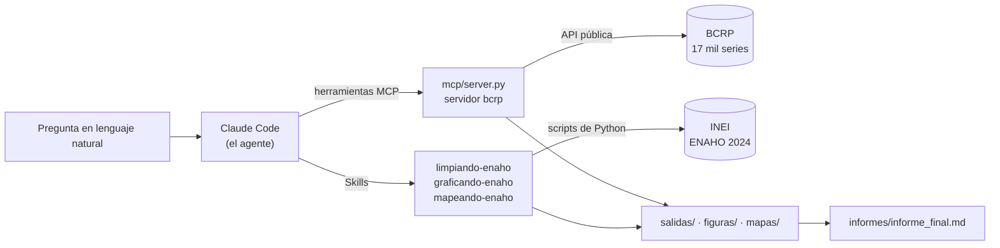

# Tarea_4

Agente de investigación socioeconómica: MCP, Skills y datos oficiales del Perú.

Tarea 4 del curso Python Intermedio ([issue #201](https://github.com/d2cml-ai/Data-Science-Python/issues/201)).
Claude Code coordina un servidor MCP con las series del BCRP y tres Skills que procesan la ENAHO 2024 del INEI, y
responde preguntas con cifras que se pueden rastrear y reproducir.

> **Estado:** Parte 1 (servidor MCP del BCRP) terminada. Las Partes 2 a 4 se completan en las siguientes entregas.

## 1. Objetivo del proyecto

Construir un agente que responda preguntas sobre la realidad socioeconómica del Perú con datos oficiales: las series
del Banco Central de Reserva (BCRP), por MCP, y los microdatos de la ENAHO 2024, por Skills de Claude Code. Cada
cifra la calcula Python y no el modelo, y sale con su código de serie o su procedimiento, su periodo y su fuente.

## 2. Arquitectura general del agente



| Pieza | Dónde está | Qué hace |
|---|---|---|
| Servidor MCP `bcrp` | `mcp/server.py` | Busca, descarga y resume series del BCRP; compara los 25 departamentos |
| Configuración MCP | `.mcp.json` | Conecta el servidor a Claude Code (alcance de proyecto) |
| Skills de la ENAHO | `.claude/skills/` | *Parte 2* |
| Registro de ejecuciones | `scripts/registro.py` | Corre `claude -p` y guarda cada llamada a herramientas como evidencia |

## 3. Herramientas MCP

El servidor parte del proyecto de la [Sesión 04](https://github.com/d2cml-ai/Data-Science-Python/tree/main/sessions/04-mcp-claude-code/proyecto)
(FastMCP 4). `buscar_series` venía hecha; el resto se completó o se agregó aquí.

| Herramienta | Qué hace | Ejemplo de argumentos |
|---|---|---|
| `buscar_series` | Busca entre las 17 167 series del catálogo del BCRP por palabras clave | `texto="ipc 12 meses"` |
| `serie` | Descarga los datos de una serie entre dos fechas (diaria, mensual, trimestral o anual), sin los «n.d.», con el enlace a la API y a la tabla web del BCRP | `codigo="PN01273PM", desde="2024-01", hasta="2024-12"` |
| `resumen` | Primero, último, cambio, variación %, promedio, máximo y mínimo con su periodo; las cuentas las hace Python | `codigo="PN01273PM", desde="2020-01", hasta="2024-12"` |
| **`panel_departamental`** (propia) | Trae un indicador anual del BCRP para los **25 departamentos** con el **código del INEI** (`ccdd`, el mismo de `ubigeo[:2]` en la ENAHO y de `FIRST_IDDP` en el mapa), con puesto, variación entre dos años, total nacional, promedio, mediana y extremos; puede guardar la tabla en `salidas/bcrp/` para unirla con la ENAHO sin copiar cifras a mano | `indicador="credito directo", anio=2024, anio_base=2020` |

**Por qué la herramienta propia.** El BCRP publica 23 indicadores por departamento (crédito, depósitos, gasto e
inversión pública, afiliados al SPP, PBI, electricidad, etc.), pero cada departamento es una serie distinta y la API
no trae el código territorial. `panel_departamental` resuelve las 25 series de una vez, las asigna a su código del
INEI con Lima y Callao separados, y avisa qué departamento falta (por ejemplo, el PBI departamental no trae Callao).
Es el puente entre el MCP del BCRP y las Skills de la ENAHO.

| Recurso o prompt | Qué devuelve |
|---|---|
| Recurso `bcrp://serie/{codigo}` | La ficha de una serie: nombre, frecuencia, inicio, fuente original y enlaces |
| Recurso `bcrp://indicadores-departamentales` | Los 23 indicadores que acepta `panel_departamental`, con sus variantes y años |
| Prompt `informe(tema, desde, hasta)` | Instrucciones para un informe con cada cifra citada (código, periodo y fuente), sin cuentas a mano y con limitaciones |

Los errores son explícitos: un código que no existe, una fecha mal escrita, un periodo anterior al inicio de la serie
o un año que el BCRP aún no publica devuelven un mensaje que lo dice, en vez de un dato inventado.

## 4. Skills de la ENAHO

*Parte 2: `limpiando-enaho`, `graficando-enaho` y `mapeando-enaho`.*

## 5. Fuentes y descarga de los datos

| Fuente | Datos | Enlace |
|---|---|---|
| BCRP | Series estadísticas (API pública, sin clave) | https://estadisticas.bcrp.gob.pe/estadisticas/series/ |
| INEI | ENAHO 2024, módulo 34 (sumaria) | https://proyectos.inei.gob.pe/iinei/srienaho/descarga/STATA/966-Modulo34.zip |
| INEI | ENAHO 2024, módulo 02 (miembros del hogar) | https://proyectos.inei.gob.pe/iinei/srienaho/descarga/STATA/966-Modulo02.zip |
| Curso | Límites departamentales del Perú | https://raw.githubusercontent.com/d2cml-ai/Data-Science-Python/main/sessions/06-geoespacial/lab/Data/peru_departamental_simple.geojson |

El servidor MCP baja solo el catálogo del BCRP (unos 7 MB) a `datos/bcrp/` y guarda cada respuesta de la API 12
horas en `datos/bcrp/cache/`. La carpeta `datos/` no se sube a GitHub. *La descarga de la ENAHO se documenta en la
Parte 2.*

## 6. Instalación con `uv`

Requisitos: [uv](https://docs.astral.sh/uv/), Claude Code con la sesión iniciada e internet.

```bash
git clone https://github.com/Cris92W/Tarea_4.git
cd Tarea_4
uv sync                  # crea .venv con Python 3.12 y las dependencias de pyproject.toml
uv run pytest            # 10 passed: las 8 pruebas de la Sesión 04 y 2 propias
```

## 7. Conectar el MCP a Claude Code

El archivo `.mcp.json` ya está en el repositorio; se creó con:

```bash
claude mcp add --scope project bcrp -- uv run mcp/server.py
```

Al abrir `claude` en la carpeta, Claude Code pide aprobar el servidor `bcrp` la primera vez. Después:

- `/mcp` lo muestra conectado, con sus 4 herramientas.
- Una pregunta: *«¿Cuál fue la inflación de Lima a 12 meses en diciembre de 2024?»*. Claude llama a `buscar_series` y
  luego a `serie` o `resumen`.
- Un recurso: `@bcrp:bcrp://serie/PN01273PM ¿desde cuándo hay datos de esta serie?`
- El prompt: `/mcp__bcrp__informe inflación 2023 2024`

## 8. Comandos para reproducir

```bash
uv run pytest -v                                   # pruebas del servidor (piden datos reales al BCRP)
uv run mcp/server.py                               # el servidor por stdio (lo arranca Claude Code)

# una ejecución de Claude Code sin interfaz, guardada como evidencia (JSONL crudo + Markdown)
uv run scripts/registro.py correr evidencias_ia/mcp/01_inflacion_lima "¿Cuál fue la inflación ...?" --mcp --herramientas ""
```

`--mcp` carga solo el servidor `bcrp` y `--herramientas ""` apaga las herramientas propias de Claude Code (archivos,
terminal, web), para que las cifras salgan únicamente del MCP. En Git Bash, un prompt que empieza con `/` debe ir con
`MSYS_NO_PATHCONV=1` delante.

## 9. Resultados de la evaluación

*Parte 4.*

## 10. Limitaciones y problemas encontrados

- **La API devuelve las series ordenadas por código**, no en el orden en que se piden. `panel_departamental` las pide
  ordenadas y comprueba el nombre de cada una antes de asignar valores; si no calzan, da un error en vez de asignar a
  ciegas.
- **Un rango sin datos devuelve una página HTML**, igual que cuando la API limita los pedidos. El servidor reintenta
  con espera y, antes de llamar, compara el periodo con el inicio de la serie en el catálogo para dar un mensaje claro.
- **La «fecha de fin» del catálogo está desactualizada** (dice diciembre de 2025 en series con datos de 2026), así que
  no se usa para rechazar pedidos.
- **Los indicadores departamentales son nominales y anuales**; para comparar años hay que considerar la inflación.
- En Git Bash, `/mcp__bcrp__informe` se convertía en una ruta de Windows; se corre con `MSYS_NO_PATHCONV=1`.

## 11. Ejemplo de una ejecución completa

*Parte 3. Por ahora, una consulta al MCP desde Claude Code:*
[`evidencias_ia/mcp/01_inflacion_lima.md`](evidencias_ia/mcp/01_inflacion_lima.md). Claude buscó la serie
(`buscar_series`), pidió el dato de diciembre (`serie`) y el resumen 2020–2024 (`resumen`), y respondió: inflación de
Lima a 12 meses de 1.97 % en diciembre de 2024, promedio de 4.47 % y máximo de 8.81 % en junio de 2022 (serie
PN01273PM), con los enlaces a la API y a la tabla del BCRP.

## 12. Evidencias del uso de inteligencia artificial

Todo está en [`evidencias_ia/`](evidencias_ia/), sin rutas personales ni correos.

| Carpeta | Contenido |
|---|---|
| [`mcp/`](evidencias_ia/mcp/) | `pruebas.txt` (10 passed, con la verificación de que `test_server.py` es idéntico al del curso) y 5 ejecuciones de Claude Code con el MCP: herramientas, herramienta propia, recursos, prompt y una consulta sin datos |
| `skills/` | *Parte 2* |
| `integracion/` | *Parte 3* |
| `evaluacion/` | *Parte 4* |

Las conversaciones completas de desarrollo con Claude Code se exportan al final del proyecto.
