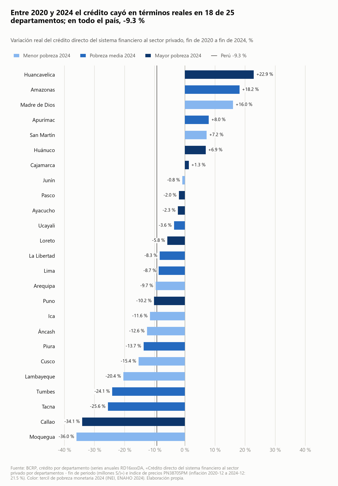
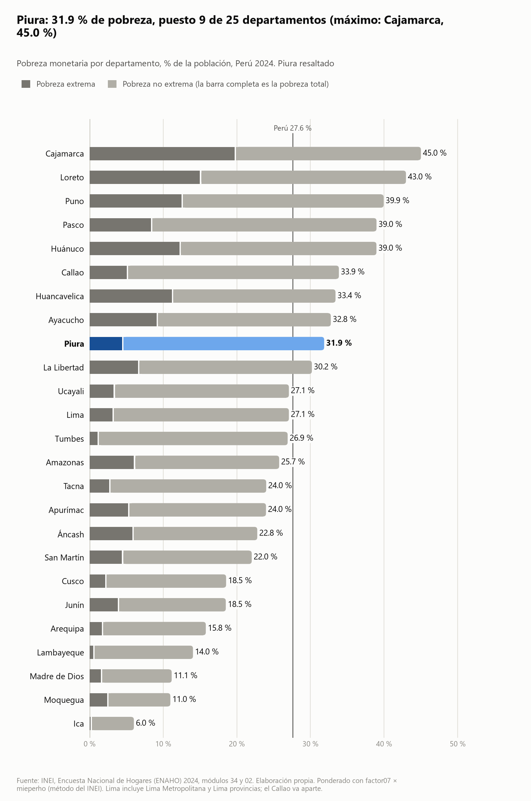
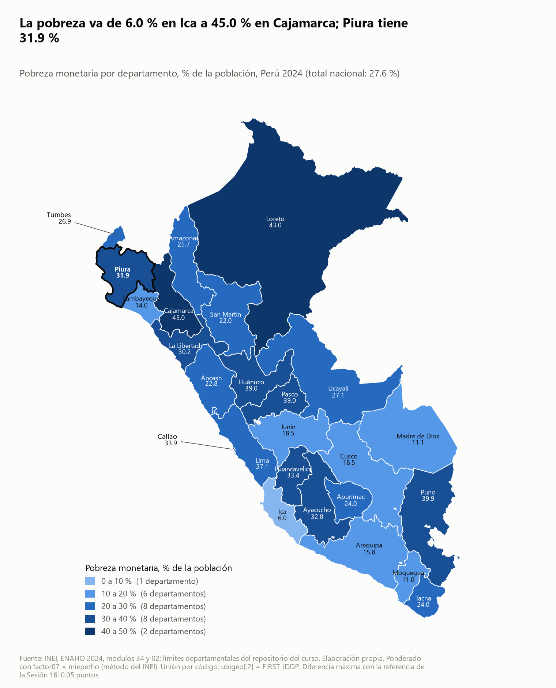
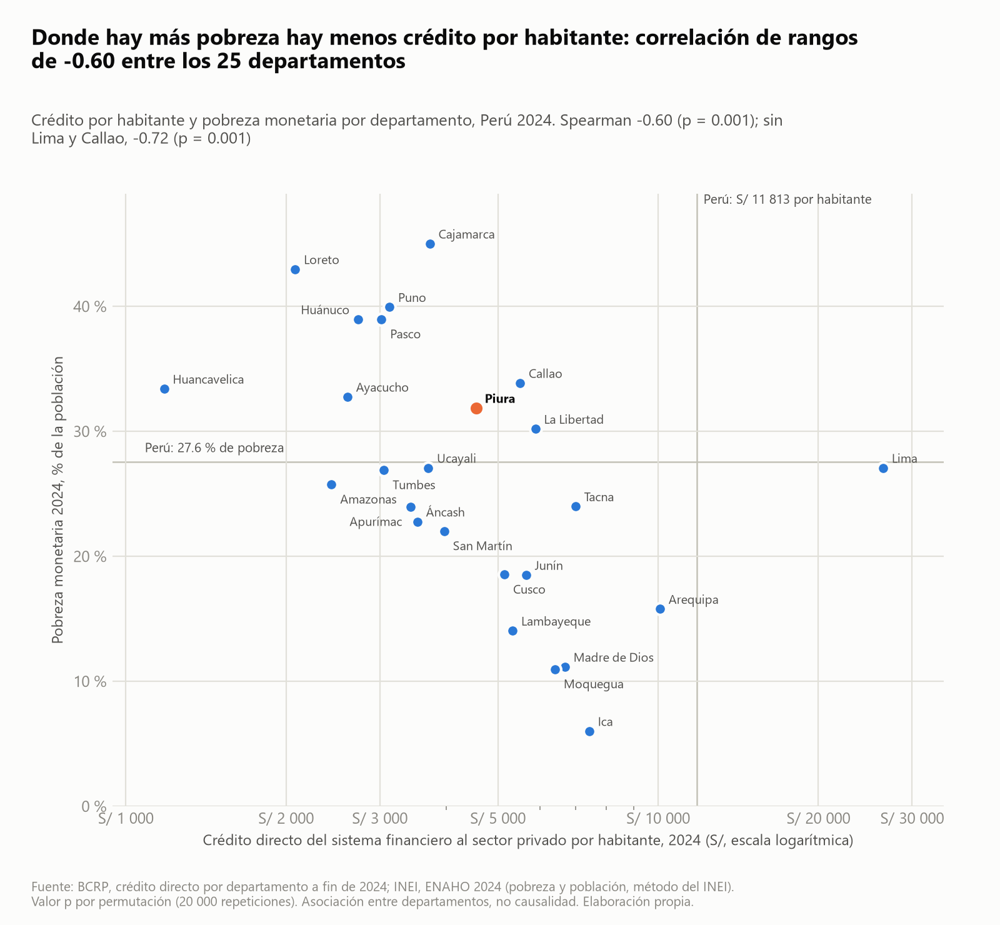

# ¿Hay menos crédito donde hay más pobreza?

## 1. Pregunta de investigación

**Pregunta textual:** «¿Qué grado de asociación hay entre la incidencia de la pobreza monetaria en 2024 y el crédito directo del sistema financiero por habitante, y cómo varió ese crédito en términos reales entre 2020 y 2024 según el nivel de pobreza de cada departamento en el Perú?»

- **Tema:** inclusión financiera territorial y pobreza monetaria.
- **Objetivo:** medir la asociación entre pobreza 2024 y crédito por habitante 2024, y describir la variación real 2020–2024 del crédito por tercil de pobreza.
- **Delimitación:** 25 departamentos (Lima y Callao separados); pobreza 2024 (ENAHO); crédito directo a fin de 2020 y fin de 2024; deflactor: IPC de Lima Metropolitana. Es un análisis descriptivo entre departamentos, no causal.

## 2. Fuentes y metodología

**Datos**
- Pobreza monetaria: INEI, ENAHO 2024, módulos 34 (sumaria) y 02 (miembros del hogar), residentes habituales (108 664 personas, 33 691 hogares). Ponderación `factor07 × mieperho` (método INEI).
- Crédito directo del sistema financiero al sector privado por departamento, fin de periodo (millones S/), BCRP, series `RD16127DA`–`RD16199DA` (25 departamentos) y `RD16202DA` (total nacional), 2020 y 2024.
- Índice de precios: BCRP `PN38705PM` (IPC Lima Metropolitana, Dic.2021=100), diciembre 2020 a diciembre 2024.
- Geometría: `datos/geo/peru_departamental_simple.geojson`; referencia de la Sesión 16: `datos/referencias/pobreza_departamento_2024.csv`.

**Procesamiento** (skills del proyecto)
1. `limpiando-enaho`: limpieza, unión m:1 y validación (19 verificaciones aprobadas, 0 fallidas; `salidas/validacion.txt`).
2. `graficando-enaho` y `mapeando-enaho`: gráfico y mapa de pobreza por departamento, unión por código `ubigeo[:2]` = `FIRST_IDDP`.
3. MCP `bcrp`: `panel_departamental` (guardar) y `serie` (guardar); `cruzando-bcrp-enaho` los une por código INEI.

**Indicadores:** crédito por habitante 2024 = crédito (S/) / población ENAHO (`factor07 × mieperho`); variación real = (V2024/V2020)/(IPC dic-2024/IPC dic-2020) − 1; Spearman con valor p por permutación (20 000 repeticiones); terciles de pobreza (9/8/8 departamentos).

## 3. Resultados

**Hallazgo 1 — Asociación negativa y significativa entre pobreza y crédito por habitante.** Spearman ρ = −0,604 (p = 0,0014, n = 25); sin Lima y Callao ρ = −0,718 (p = 0,0005, n = 23). Fuente: `salidas/cruce_credito_directo.json`. Las medianas por habitante bajan de S/ 5 649,7 (menor pobreza) a S/ 4 125,4 (media) y S/ 2 878,0 (mayor pobreza), según el mismo archivo.

**Hallazgo 2 — Gran brecha y concentración.** Lima concentra 73,27 % del crédito nacional (2024); Lima tiene S/ 26 460,5 por habitante y Huancavelica S/ 1 180,2, una brecha de 22,4 veces (`cruce_credito_directo.json`, series `RD16169DA`, `RD16151DA`, `RD16202DA`, 2024).

**Hallazgo 3 — En términos reales el crédito cayó en la mayoría de departamentos, y menos donde hay más pobreza.** El crédito nacional subió 10,15 % nominal pero bajó 9,35 % real (inflación dic-2020 a dic-2024: 21,51 %, `PN38705PM`). 18 de 25 departamentos tuvieron caída real. Mediana de variación real por tercil: −11,58 % (menor pobreza), −8,50 % (media) y −2,14 % (mayor pobreza). Sin embargo, la correlación entre pobreza y variación real es débil y no significativa (ρ = 0,207; p = 0,321); con n = 25, esto no prueba que no haya relación.
Los 7 departamentos con aumento real son Huancavelica (+22,9 %), Amazonas (+18,2 %), Madre de Dios (+16,0 %), Apurímac (+8,0 %), San Martín (+7,2 %), Huánuco (+6,9 %) y Cajamarca (+1,3 %) (cálculo sobre `salidas/cruce_credito_directo.csv`). Por tercil, hubo caída real en 7 de 9 (menor pobreza), 6 de 8 (media) y 5 de 8 (mayor pobreza).

**Hallazgo 4 — Piura.** Pobreza 2024: 31,86 % (puesto 9 de 25 de mayor a menor pobreza); crédito por habitante S/ 4 550,6 (puesto 12 de mayor a menor); es el 4.º departamento por monto total (S/ 9 049,1 millones en 2024, `RD16184DA`), pero su variación real fue −13,71 % (puesto 19 de 25 de mayor a menor variación), peor que la mediana de su tercil (pobreza media, −8,50 %). Cálculo con comandos sobre `cruce_credito_directo.csv`.

**Validaciones**
- ENAHO frente al INEI: pobreza nacional 27,58 % (método INEI) frente a la cifra oficial de 27,6 % (`salidas/validacion.txt`, APROBADA, tolerancia 0,1 pp).
- Mapa frente a la Sesión 16: 25 de 25 departamentos coinciden a 0,1 pp o menos; diferencia máxima 0,05 pp (`salidas/comparacion_mapa.csv`).
- Cifra del BCRP contra su tabla web (`fuente_web`: https://estadisticas.bcrp.gob.pe/estadisticas/series/anuales/resultados/RD16127DA-RD16130DA-RD16133DA-RD16136DA-RD16139DA-RD16142DA-RD16145DA-RD16148DA-RD16151DA-RD16154DA-RD16157DA-RD16160DA-RD16163DA-RD16166DA-RD16169DA-RD16172DA-RD16175DA-RD16178DA-RD16181DA-RD16184DA-RD16187DA-RD16190DA-RD16193DA-RD16196DA-RD16199DA-RD16202DA/html/2020/2024/): consulté la tabla web de Lima, Piura y el total (`RD16169DA`, `RD16184DA`, `RD16202DA`) y coinciden con el MCP: Lima 268 953 → 298 472; Piura 8 630 → 9 049; total 369 826 → 407 352 (millones S/, 2020 → 2024). Nota: la consulta web usó una URL con solo esas tres series, no el enlace completo de las 26 series.

## 4. Visualizaciones









## 5. Interpretación

Los departamentos más pobres tienden a tener menos crédito por habitante: la asociación es moderada a fuerte y no se debe al azar según la prueba de permutación. El crédito real cayó casi en todas partes en 2020–2024 porque creció menos que los precios, y la caída mediana fue menor en el tercil más pobre. Esto último probablemente refleja que partían de niveles muy bajos (p. ej. Huancavelica, +49,3 % nominal), pero esa explicación no se ha probado aquí. Son asociaciones entre departamentos; no se afirma que la pobreza cause el menor crédito ni lo contrario.

## 6. Limitaciones

- **Cobertura temporal:** pobreza solo 2024 (ENAHO); crédito comparado solo entre fines de 2020 y 2024, sin trayectoria intermedia. No se mide la pobreza de 2020.
- **Calidad de los datos:** la ENAHO es una encuesta con error muestral; las cifras departamentales no traen intervalos de confianza aquí. La población usada para el per cápita es la expandida de la ENAHO (34,5 millones con `factor07 × mieperho`), no una proyección demográfica oficial. El crédito se asigna a departamentos según el criterio de la SBS/BCRP, no verificado aquí; parte de la concentración en Lima puede deberse a ello. El IPC de Lima se aplica a todos los departamentos.
- **Alcance:** n = 25; falacia ecológica (no se dice nada de los hogares); no es causalidad. El crédito directo incluye empresas y personas; no mide acceso de hogares pobres. Cajamarca, que es el más pobre, y Callao (clasificado en el tercil de mayor pobreza, 33,86 %) muestran que el patrón no es uniforme.

## 7. Reproducibilidad

Comandos (desde la raíz del proyecto):
```bash
uv run .claude/skills/limpiando-enaho/scripts/limpiar.py
uv run .claude/skills/graficando-enaho/scripts/graficar.py --tipo departamento --resaltar Piura
uv run .claude/skills/mapeando-enaho/scripts/mapear.py --resaltar Piura
# MCP bcrp: panel_departamental(indicador="credito directo", anio=2024, anio_base=2020, guardar=True)
# MCP bcrp: serie(codigo="PN38705PM", desde="2020-12", hasta="2024-12", guardar=True)
uv run .claude/skills/cruzando-bcrp-enaho/scripts/cruzar.py --panel salidas/bcrp/panel_credito_directo_sistema_2024_2020.csv --ipc salidas/bcrp/serie_PN38705PM_2020-12_2024-12.csv --resaltar Piura
```
Archivos: `salidas/validacion.txt`, `salidas/indicadores.csv`, `salidas/comparacion_mapa.csv`, `salidas/cruce_credito_directo.{csv,json}`, `salidas/bcrp/*.csv`, `figuras/*.png|csv`, `mapas/*.png|csv`, `informes/plan_analisis.md`.
Series BCRP: `RD16127DA`…`RD16199DA`, `RD16202DA`, `PN38705PM`. Al buscar un índice de precios con `buscar_series`, las primeras búsquedas devolvieron solo variaciones %; usé `PN38705PM` (índice, confirmado con `serie`) porque la búsqueda por texto no la listó directamente.
